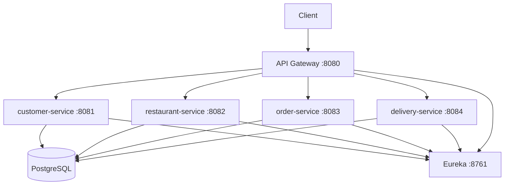

# Food Delivery Microservices

A Spring Boot microservices project with service discovery, API gateway, and four domain services.

## Architecture

```
         Client
           |
     +-----------+
     | API Gateway| :8080
     +-----------+
           |
  ┌────────┼────────┬────────┐
  ▼        ▼        ▼        ▼
Customer  Restaurant  Order  Delivery
 :8081     :8082     :8083   :8084
  └────────┴────────┴────────┘
                |
        +--------------+
        |   PostgreSQL  |
        +--------------+
                |
        +--------------+
        |    Eureka     | :8761
        | (Discovery)   |
        +--------------+
```



## Services

| Service | Port | Description |
|---|---|---|
| API Gateway | 8080 | Single entry point, routes all requests |
| Service Discovery | 8761 | Eureka server |
| Customer Service | 8081 | Manage customers |
| Restaurant Service | 8082 | Manage restaurants |
| Order Service | 8083 | Manage orders |
| Delivery Service | 8084 | Manage deliveries |

## API Endpoints (via Gateway on :8080)

### Customers
```
POST   /api/customers
GET    /api/customers
GET    /api/customers/{id}
DELETE /api/customers/{id}
```

### Restaurants
```
POST   /api/restaurants
GET    /api/restaurants
GET    /api/restaurants/{id}
DELETE /api/restaurants/{id}
```

### Orders
```
POST   /api/orders
GET    /api/orders
GET    /api/orders/{id}
DELETE /api/orders/{id}
```

### Deliveries
```
POST   /api/deliveries
GET    /api/deliveries
GET    /api/deliveries/{id}
DELETE /api/deliveries/{id}
```

## Running Locally

```bash
# Build all services
mvn clean package -DskipTests

# Start all containers
docker compose up --build -d

# View logs
docker compose logs -f
```

## Example Request Flow

```
POST http://localhost:8080/api/customers
{
  "name": "Alice",
  "email": "alice@example.com",
  "phone": "0781234567"
}
```
